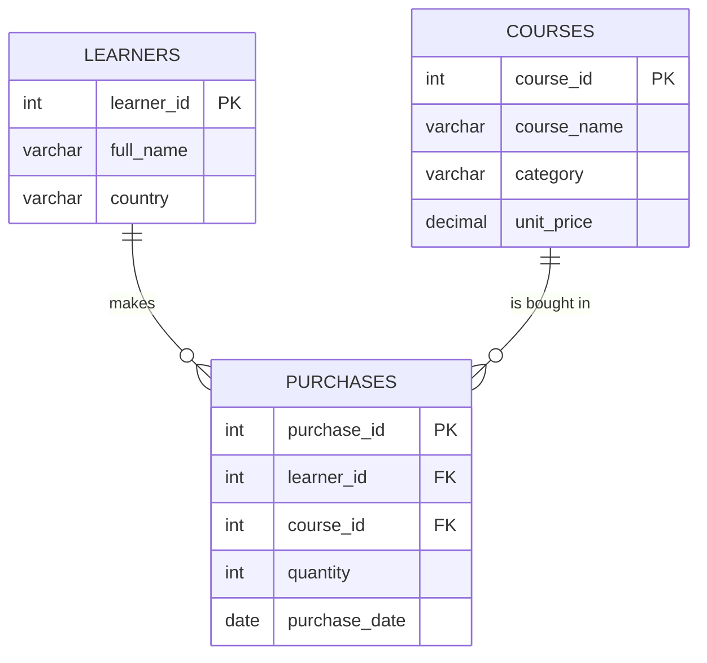

# E-Learning Platform: SQL Database & Joins


A MySQL project that models an online course platform with three related tables (`learners`, `courses`, `purchases`) and uses SQL joins to answer questions such as *who bought which course, and how much did they pay?*

## Table of Contents

- [Overview](#overview)
- [Database Schema](#database-schema)
- [Sample Data](#sample-data)
- [Queries](#queries)
- [Final Query & Output](#final-query--output)
- [Notes](#notes)
- [How to Run](#how-to-run)
- [Skills Demonstrated](#skills-demonstrated)
- [Repository Structure](#repository-structure)

## Overview

The script `SQL_final_assn.sql` does four things:

1. Creates the `e_platform` database and its three tables with primary and foreign keys.
2. Fixes a column name typo and changes a data type with `ALTER TABLE`.
3. Inserts sample data for 6 learners, 5 courses and 9 purchases.
4. Explores the data with `INNER`, `LEFT` and `RIGHT` joins, including a calculated `total_amount`.

## Database Schema



| Table | Columns | Purpose |
|-------|---------|---------|
| `learners` | `learner_id` (PK), `full_name`, `country` | students on the platform |
| `courses` | `course_id` (PK), `course_name`, `category`, `unit_price` | courses on offer |
| `purchases` | `purchase_id` (PK), `learner_id` (FK), `course_id` (FK), `quantity`, `purchase_date` | links learners to the courses they bought |

`purchases` is the link table: each row connects one learner to one course through foreign keys.

## Sample Data

**Learners (6)**

| learner_id | full_name | country |
|-----------|-----------|---------|
| 1001 | Pradeep | India |
| 1002 | Johan | USA |
| 1003 | Dala | Indonesia |
| 1004 | Ramesh | India |
| 1005 | Peter | UK |
| 1006 | Linda | USA |

**Courses (5)**

| course_id | course_name | category | unit_price |
|-----------|-------------|----------|-----------|
| 1 | Data_Analytics | IT | 3000 |
| 2 | Data_science | IT | 4000 |
| 3 | CCNA | Networking | 3500 |
| 4 | Med_code | Healthcare | 2000 |
| 5 | statistics | Banking | 2000 |

**Purchases (9):** 9 orders between 2026-04-08 and 2026-05-25, each with a quantity of 1.

## Queries

| # | Query | Join type | Returns |
|---|-------|-----------|---------|
| 1 | Learners and their purchases | `JOIN` (inner) | `learner_id`, `full_name`, `purchase_id`, `purchase_date` |
| 2 | Change `unit_price` to `DECIMAL(10,2)` | `ALTER TABLE` | prepares prices for accurate amounts |
| 3 | Courses and their purchases | `LEFT JOIN` | `course_name`, `category`, `total_amount`, `purchase_date` |
| 4 | Learners and their purchase dates | `RIGHT JOIN` | `learner_name`, `purchase_date` |
| 5 | Learners, courses and totals | `LEFT JOIN` + `RIGHT JOIN` | `learner_name`, `course_name`, `category`, `total_amount`, `purchase_date` |
| 6 | Complete purchase report | `INNER JOIN` on all three tables | `Learner_Name`, `Course_Name`, `category`, `quantity`, `Total_Amount`, `purchase_date` |

The total for each purchase is calculated as:

```sql
(c.unit_price * p.quantity) AS Total_Amount
```

## Final Query & Output

The last query combines all three tables into one report:

```sql
SELECT
    l.full_name AS Learner_Name,
    c.course_name AS Course_Name,
    c.category,
    p.quantity,
    (c.unit_price * p.quantity) AS Total_Amount,
    p.purchase_date
FROM learners l
INNER JOIN purchases p ON l.learner_id = p.learner_id
INNER JOIN courses c   ON p.course_id = c.course_id;
```

**Expected result (9 rows)**

| Learner_Name | Course_Name | category | quantity | Total_Amount | purchase_date |
|--------------|-------------|----------|----------|--------------|---------------|
| Pradeep | CCNA | Networking | 1 | 3500.00 | 2026-05-25 |
| Pradeep | statistics | Banking | 1 | 2000.00 | 2026-05-21 |
| Johan | Med_code | Healthcare | 1 | 2000.00 | 2026-04-22 |
| Dala | Med_code | Healthcare | 1 | 2000.00 | 2026-05-23 |
| Ramesh | Data_Analytics | IT | 1 | 3000.00 | 2026-04-16 |
| Ramesh | Data_science | IT | 1 | 4000.00 | 2026-04-08 |
| Peter | statistics | Banking | 1 | 2000.00 | 2026-05-11 |
| Linda | Med_code | Healthcare | 1 | 2000.00 | 2026-04-23 |
| Peter | CCNA | Networking | 1 | 3500.00 | 2026-05-14 |

Row order may differ, since the query has no `ORDER BY`.

## Notes

- **Schema fix:** the `learners` table was first created with a misspelled column, `leaner_id`. It is corrected with `ALTER TABLE learners RENAME COLUMN leaner_id TO learner_id;`, which needs **MySQL 8.0+**.
- **Same results from different joins:** every learner and every course has at least one purchase, so the `LEFT` and `RIGHT` joins return the same rows as an `INNER JOIN` on this data. They would differ if a learner or course had no purchases.
- **`GROUP BY` without aggregates:** queries 3 to 5 use `GROUP BY` but no aggregate functions, so it only removes duplicate rows, like `DISTINCT`.
- **Query 3** shows course details but not the learner's name, which is added in queries 5 and 6.
- **Re-running the script:** it creates the database and tables without `IF NOT EXISTS`, so a second run fails. Run `DROP DATABASE e_platform;` first.

## How to Run

**Prerequisites:** MySQL 8.0+ and a client such as MySQL Workbench or the `mysql` command line.

```bash
git clone https://github.com/<your-username>/<your-repo-name>.git
cd <your-repo-name>
mysql -u root -p < SQL_final_assn.sql
```

Or open `SQL_final_assn.sql` in MySQL Workbench and run it with the lightning-bolt button. Use `Ctrl+Enter` to run one statement at a time and inspect each query's output.

## Skills Demonstrated

- Database and table design with primary and foreign keys
- `CREATE`, `ALTER` (rename and modify column), `INSERT`
- `INNER`, `LEFT` and `RIGHT` joins, including three-table joins
- Table aliases and column aliases
- Calculated columns (`quantity * unit_price`)
- `GROUP BY` and understanding when outer joins matter

## Repository Structure

```text
.
├── SQL_final_assn.sql
└── README.md
```
